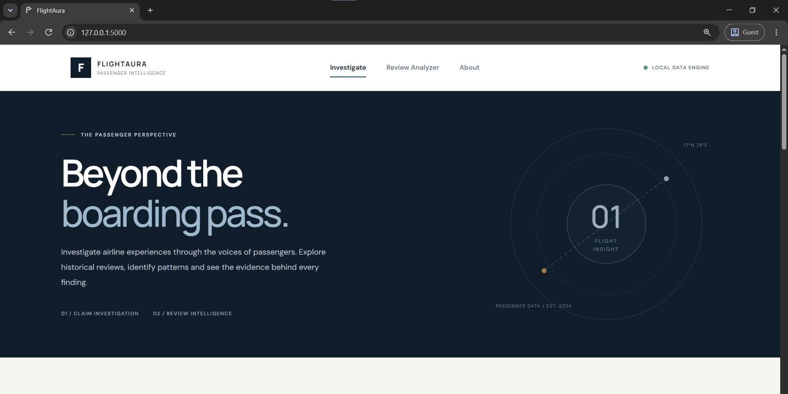
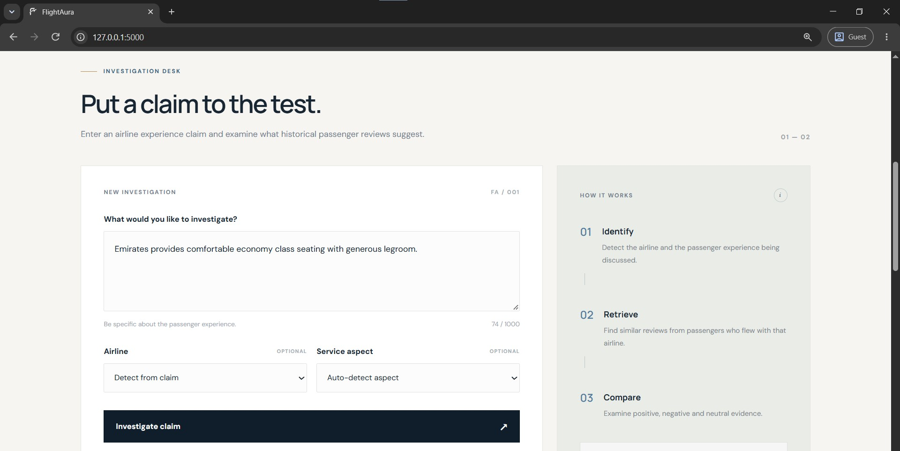
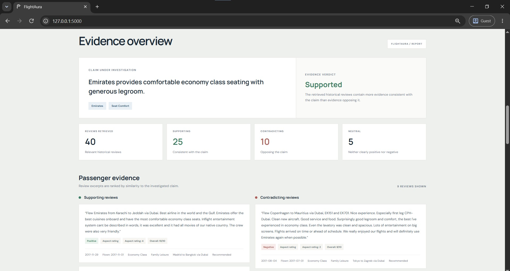
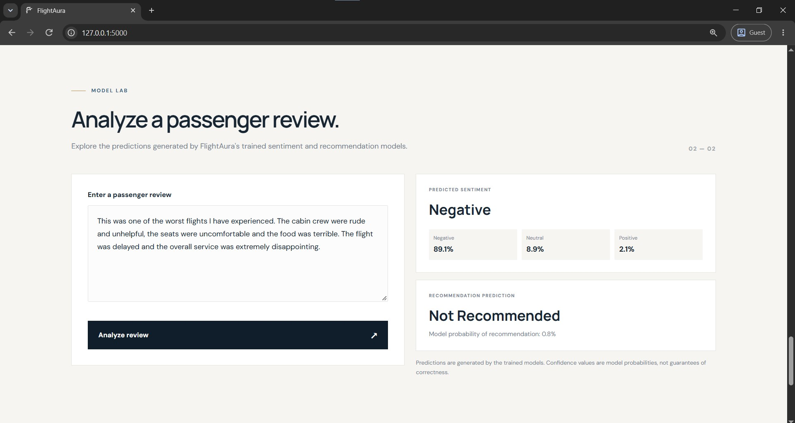

# FlightAura – Airline Review Intelligence Platform

**FlightAura** is an AI-powered airline review intelligence platform that analyzes passenger feedback to uncover customer sentiment, predict travel recommendations, and investigate claims about airline services. It combines Machine Learning, Deep Learning, Natural Language Processing, and similarity-based review retrieval to transform unstructured passenger reviews into meaningful insights.

The platform provides two main functionalities: **Review Analysis**, which predicts the sentiment and recommendation of an individual passenger review, and **Claim Investigation**, which retrieves relevant passenger experiences to evaluate whether a particular claim about an airline is supported by the available evidence.

## How It Works

FlightAura consists of two interconnected analysis workflows.

### 1. Claim Investigation

1. The user enters a claim about an airline and selects the relevant airline and service aspect.
2. The claim is processed to identify its subject, aspect, and positive or negative direction.
3. The system filters the review dataset to retrieve reviews associated with the selected airline.
4. TF-IDF vectorization and cosine similarity are used to identify relevant passenger experiences.
5. Retrieved reviews are evaluated using structured aspect ratings, aspect-related review text, or the sentiment prediction model when necessary.
6. The evidence is grouped into supporting, contradicting, and neutral categories.
7. FlightAura presents a verdict based on the available evidence, along with the relevant passenger reviews.

### 2. Review Analysis

1. The user enters an individual passenger review.
2. The text is cleaned and transformed into the required model inputs.
3. The selected sentiment models generate class probability predictions.
4. The Weighted Soft Voting system combines predictions to determine the overall sentiment.
5. The BiLSTM recommendation model predicts whether the passenger would recommend the airline.
6. The results are displayed through the web interface.

## Screenshots

The following screenshots showcase the main functionalities and interface of FlightAura.

1. **Home Page** – The FlightAura landing page featuring the aviation-inspired interface and the two primary functionalities: Claim Investigation and Review Analysis.



2. **Claim Investigation** – The claim investigation interface where users enter an airline-related claim and select the airline and service aspect they want to investigate.



3. **Evidence Analysis** – Displays the investigation verdict along with supporting, contradicting, and neutral passenger reviews retrieved from the dataset.



4. **Review Analysis** – Shows the sentiment classification and recommendation prediction generated for an individual passenger review.



## Features

- **AI-Powered Review Analysis**
  - Accepts passenger reviews as natural-language input.
  - Predicts the overall sentiment as Positive, Negative, or Neutral.
  - Predicts whether the passenger would recommend the airline.
  - Uses a combination of classical Machine Learning and Deep Learning models for sentiment prediction.

- **Intelligent Claim Investigation**
  - Allows users to investigate claims about specific airlines.
  - Identifies the airline, service aspect, and claim direction from the input.
  - Retrieves relevant passenger reviews using TF-IDF-based similarity.
  - Evaluates retrieved reviews to identify supporting, contradicting, and neutral evidence.
  - Generates an evidence-based verdict: Supported, Contradicted, Mixed Evidence, or Insufficient Evidence.

- **Aspect-Based Evidence Analysis**
  - Investigates specific airline service aspects, including:
    - Seat Comfort
    - Cabin Staff Service
    - Food and Beverages
    - Ground Service
    - Wi-Fi and Connectivity
    - In-flight Entertainment
    - Value for Money
    - Overall Experience
  - Uses structured passenger ratings wherever available.
  - Uses aspect-related review sentences and model predictions as alternative evidence sources when structured ratings are unavailable.

- **Review Retrieval and Ranking**
  - Retrieves relevant reviews from the processed airline review dataset.
  - Uses TF-IDF vectorization and cosine similarity to identify matching passenger experiences.
  - Prioritizes reviews related to the selected airline and service aspect.

- **Evidence-Based Results**
  - Displays supporting and contradicting passenger experiences.
  - Includes relevant review information and available passenger metadata.
  - Provides an evidence breakdown to make the investigation results easier to interpret.

- **Interactive Web Interface**
  - Airline and service-aspect selection.
  - Dedicated interfaces for claim investigation and review analysis.
  - Dynamic result rendering without requiring a page refresh.
  - Responsive layout with aviation-inspired styling.

- **Input Validation and Error Handling**
  - Handles empty or invalid review submissions.
  - Validates airline and service-aspect selections.
  - Handles cases where insufficient relevant reviews are available.
  - Provides appropriate error messages and fallback results.

## Tech Stack

- **Frontend**: HTML5, CSS3, JavaScript
  - HTML5 for the application structure and content.
  - CSS3 for the custom aviation-inspired interface, responsive layouts, and visual styling.
  - JavaScript for form handling, API communication, dynamic content rendering, and displaying investigation results.

- **Backend**: Python, Flask
  - Flask for building the web application and REST API endpoints.
  - Python for application logic, data processing, and model integration.
  - Flask manages communication between the frontend, ML models, and review retrieval pipeline.

- **Machine Learning**: Scikit-learn
  - TF-IDF Vectorization for converting textual reviews into numerical representations.
  - Logistic Regression for classical sentiment classification.
  - Artificial Neural Network (ANN) for deep feature-based classification.
  - Truncated SVD for dimensionality reduction in the ANN preprocessing pipeline.
  - Naive Bayes for comparative sentiment classification experiments.
  - Weighted Soft Voting for combining multiple sentiment model predictions.

- **Deep Learning**: TensorFlow, Keras
  - ANN for learning non-linear relationships in extracted text features.
  - Gated Recurrent Unit (GRU) for sequential text classification.
  - Long Short-Term Memory (LSTM) for capturing contextual information in passenger reviews.
  - Bidirectional LSTM (BiLSTM) for learning contextual information from both directions of a text sequence.
  - Self-Attention and SimpleRNN architectures were also explored during model experimentation.

- **Natural Language Processing**: Scikit-learn, TensorFlow/Keras
  - Text cleaning and preprocessing.
  - Tokenization and sequence padding.
  - TF-IDF-based text representation.
  - Word2Vec embeddings using CBOW and Skip-gram approaches.
  - Sentence-level processing for extracting aspect-related evidence.

- **Data Processing**: Pandas, NumPy, SciPy
  - Dataset cleaning and preprocessing.
  - Exploratory data analysis and statistical operations.
  - Numerical transformations and model input preparation.

- **Model Persistence**: Joblib, Keras
  - Joblib for saving and loading classical ML models and preprocessing objects.
  - Keras model files for storing trained Deep Learning architectures.
  - JSON configuration files for maintaining model and tokenizer settings.

- **Configuration and Utilities**: python-dotenv, Python Standard Library
  - Environment variables for managing application configuration.
  - Reusable utility functions for dataset loading, text cleaning, column mapping, and data validation.

## Model Selection and Performance

FlightAura uses different model configurations for its two prediction tasks.

| Task | Selected Model | Test Macro F1 |
|---|---|---:|
| Sentiment Classification | Weighted Soft Voting (Logistic Regression + ANN + GRU + BiLSTM) | 0.7110 |
| Recommendation Prediction | BiLSTM | 0.8979 |

**Sentiment Classification:** The selected Weighted Soft Voting system combines predictions from Logistic Regression, ANN, GRU, and BiLSTM. Combining these models helps leverage both traditional text representations and sequential patterns learned by Deep Learning architectures.

**Recommendation Prediction:** The BiLSTM model was selected based on validation performance and achieved a test Macro F1-score of 0.8979.

The reported values are from the model evaluation performed during development. Actual predictions may vary depending on the input review and the available dataset evidence.

## Getting Started

### 1. Clone the Repository

```bash
git clone https://github.com/your-username/FlightAura.git
cd FlightAura
```

### 2. Create a Virtual Environment

Make sure Python 3.11 is installed.

```bash
# Create a virtual environment
python -m venv .venv

# Activate the virtual environment (Windows)
.venv\Scripts\activate
```

### 3. Install Dependencies

```bash
# Upgrade pip
python -m pip install --upgrade pip

# Install project dependencies
pip install -r requirements.txt
```

### 4. Dataset and Model Setup

FlightAura requires the processed airline review dataset and the trained model artifacts generated during the development notebooks.

Ensure that the following files and directories are available:

**Dataset:**

```text
dataset/
└── processed/
    └── airline_reviews_unique.csv
```

**Trained Models:**

```text
models/
├── classical/
├── deep_learning/
└── embeddings/
```

The application loads the trained models and preprocessing configurations from these directories when it starts.

### 5. Environment Configuration

Create a `.env` file in the root project directory.

Add the following configuration:

```env
FLASK_DEBUG=true
SECRET_KEY=flightaura-local-development-key

FLIGHTAURA_DATASET=dataset/processed/airline_reviews_unique.csv

FLIGHTAURA_DL_DIR=models/deep_learning
FLIGHTAURA_CLASSICAL_DIR=models/classical

MAX_EVIDENCE_REVIEWS=6
MIN_RETRIEVAL_SIMILARITY=0.03
```

These variables configure the Flask application, dataset location, model directories, and review retrieval settings.

For deployment, use a secure secret key and disable Flask debug mode.

### 6. Run the Application

From the root FlightAura directory, execute:

```bash
python app.py
```

Once the Flask server starts, open the local address displayed in the terminal. The default Flask development address is usually:

```text
http://127.0.0.1:5000/
```

## Application API Endpoints

FlightAura uses Flask API endpoints to connect the frontend with its backend functionality.

| Method | Endpoint | Description |
|---|---|---|
| GET | `/` | Loads the main FlightAura application. |
| GET | `/api/health` | Checks application and model-service availability. |
| GET | `/api/airlines` | Retrieves the available airlines. |
| GET | `/api/aspects` | Retrieves the supported service aspects. |
| POST | `/api/investigate` | Processes an airline claim and returns its evidence analysis. |
| POST | `/api/analyze-review` | Analyzes an individual passenger review. |

## Project Structure

```bash
FlightAura/
│
├── app.py                          # Flask application and API routes
├── model_service.py                # Loads trained ML/DL models and generates predictions
├── claim_engine.py                 # Claim processing, review retrieval, and evidence analysis
├── utils.py                        # Dataset loading, text cleaning, and utility functions
│
├── templates/
│   └── index.html                  # Main application interface
│
├── static/
│   ├── css/
│   │   └── style.css               # Application styling and responsive layouts
│   ├── js/
│   │   └── script.js               # Frontend interactions and API communication
│   └── images/
│       └── favicon-circle.png      # FlightAura website favicon
│
├── dataset/
│   ├── airlines_reviews.csv        # Original airline review dataset
│   └── processed/
│       ├── airline_reviews_cleaned.csv
│       └── airline_reviews_unique.csv
│
├── models/
│   ├── classical/
│   │   ├── classical_tfidf_vectorizer.joblib
│   │   ├── logisticregression_sentiment.joblib
│   │   ├── naivebayes_sentiment.joblib
│   │   ├── ann_tfidf_vectorizer.joblib
│   │   ├── ann_truncated_svd.joblib
│   │   └── ann_scaler.joblib
│   │
│   ├── deep_learning/
│   │   ├── ann_sentiment.keras
│   │   ├── ann_recommendation.keras
│   │   ├── gru_sentiment.keras
│   │   ├── bilstm_sentiment.keras
│   │   ├── bilstm_recommendation.keras
│   │   ├── lstm_sentiment.keras
│   │   ├── selfattention_sentiment.keras
│   │   ├── simplernn_sentiment.keras
│   │   ├── flightaura_tokenizer.json
│   │   ├── sequence_config.json
│   │   ├── sentiment_ensemble_config.json
│   │   ├── final_sentiment_config.json
│   │   └── recommendation_config.json
│   │
│   └── embeddings/
│       ├── flightaura_embedding_matrix.npy
│       ├── flightaura_word2vec_skipgram.model
│       ├── flightaura_word2vec_cbow.model
│       └── flightaura_word2vec_vectors.kv
│
├── notebooks/                      # Dataset analysis, preprocessing, and model development
│
├── screenshots/                    # Application screenshots for README
│
├── .env                            # Local environment configuration (not committed)
├── .env.example                    # Example environment configuration
├── .gitignore
├── requirements.txt
└── README.md
```

## Future Work

- Expand the airline review dataset to include more airlines and recent passenger experiences.
- Improve aspect-level sentiment detection for more accurate claim investigation.
- Introduce more advanced semantic retrieval techniques to improve evidence relevance.
- Add interactive visualizations for comparing airlines and their service aspects.
- Improve the handling of neutral and mixed-sentiment passenger reviews.
- Add report export functionality for claim investigation results.

---

Made by **Abhishek Karthik** – CSE (AIML)